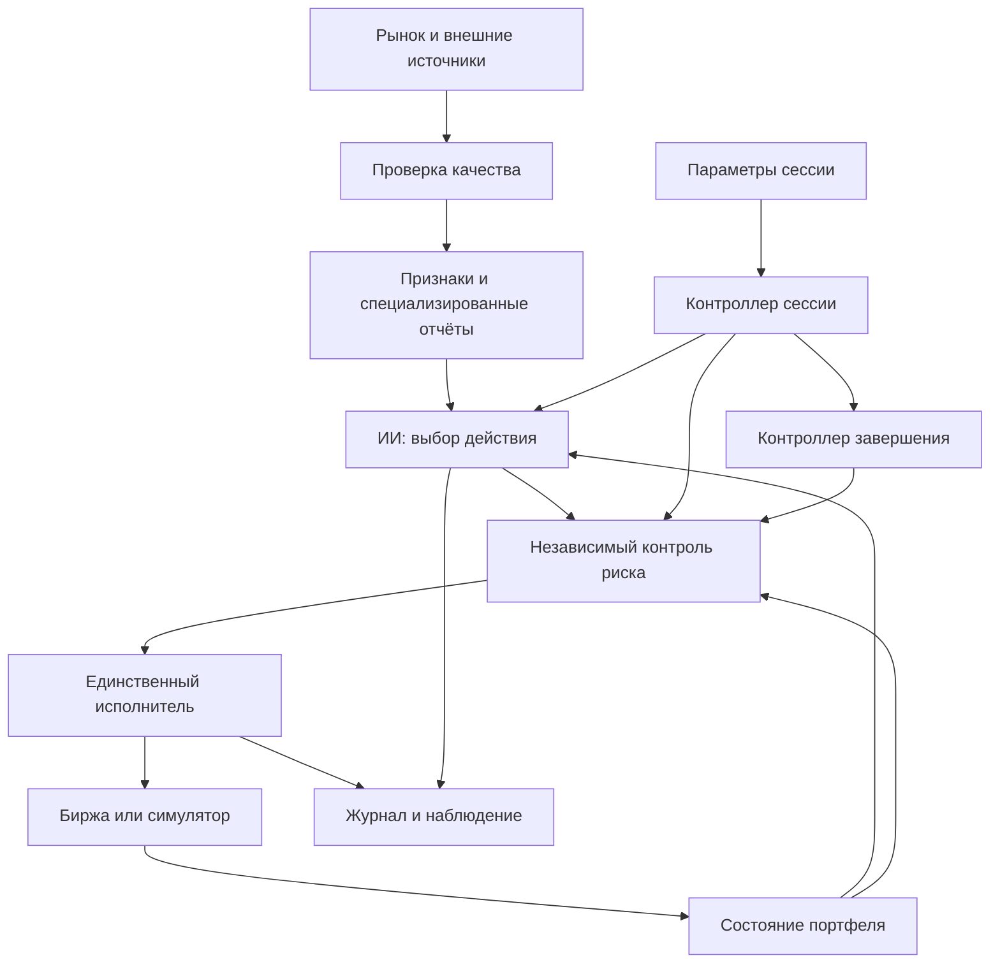

# Traid AI

Проект автономной криптоторговой системы с ИИ, специализированными обработчиками данных и независимым контролем риска.

18.10.2026 по выбору пользователя для новых сессий отключён обязательный часовой MAX_HOLD; его можно задать отдельно. Исправлена зацикленная сверка terminal pending, для остановленной UNRESOLVED-сессии доступна проверка начислений без возобновления торговли. Актуальная панель — [8788](http://127.0.0.1:8788/). Подробности и границы расследования — [BALANCE_RECONCILIATION.md](docs/BALANCE_RECONCILIATION.md).

18.10.2026 исправлены два P1 исполнения: исходный AI-снимок повторно проверяется непосредственно перед POST, MAX_HOLD обнаруживается без новой котировки. Добавлены 11 регрессий; полный набор — 296 Python-тестов. Лаунчер требует `execution-safety-guards-v1`, поэтому прежняя панель не считается совместимой. Для применения запустите `launch-dashboard.cmd`; работающие процессы в ходе исправления не заменялись. Подробности — [EXECUTION_AUDIT_20261018.md](docs/EXECUTION_AUDIT_20261018.md).

17–18.10.2026 обновлена панель: удаление завершённых архивов с подтверждением, поиск сессий, масштабирование и перетаскивание графика, поиск и страницы журнала. Управление и ограничения — [PANEL.md](docs/PANEL.md).

18.10.2026 готовый ответ Qwen будит исполнителя и проверяется без ожидания следующей котировки. Ошибки имеют отдельные безопасные коды; JSON-схема ограничивает целые допустимые решения. Риск, свежесть и старые сессии сохранены. Проверены 285 тестов и настоящая 9B без торговли; capability qwen-result-delivery-v1. Подробности — [MODELS.md](docs/MODELS.md).

17.10.2026 исправлена потеря предложений входа Qwen во время фоновой сверки Alpaca Paper. Причина отсутствия сделок, проверки и направление оценки доходности — [PROFITABILITY.md](docs/PROFITABILITY.md). Исправленная панель имеет capability `broker-decision-handoff-v1`; старый процесс нужно заменить после завершения его сессии.

**Статус на 15 октября 2026 года: paper-прототип 0.8.0 с выбором локальной Qwen 3.5 4B / 9B.** Панель управляет сессиями, показывает решения ИИ, графики, историю и отчёт. Qwen получает обработанный снимок и предлагает действие; риск, дедлайн, журнал и исполнитель Alpaca работают в коде. Остальная архитектура комплекса остаётся целевым предложением.

Актуальная панель: [http://127.0.0.1:8788/](http://127.0.0.1:8788/). В блоке «Главный ИИ» выбери 4B или 9B и подключи её перед новой сессией. 9B скачана и проверена; для неё общий бюджет решения 25 секунд, для 4B — 20 секунд. Проверка свежести 30 секунд сохранена.

Новые сессии Qwen включают ограниченное рассуждение с прежним строгим JSON-ответом. Обдумывание и возможное завершение ответа работают в фоне в общем бюджете 20 секунд; старые сессии сохраняют прежний режим. Нужны перезапуск панели и новая сессия. Проверка настоящей 4B и границы изменения — [MODELS.md](docs/MODELS.md).

Раздел **Alpaca Paper Only** подключает виртуальный счёт по ключам, показывает баланс, позиции, заявки и BTC/USD. Режим «Alpaca · виртуальные ордера» отправляет лимитные IOC-входы и рыночные выходы через независимый контроль риска. Частичные исполнения и неизвестный результат сверяются с брокером; намерение сохраняется до отправки. Официальный MCP 2.4.0 остаётся отключённым и ограниченным данными. Статус внешней проверки и инструкция — [ALPACA.md](docs/ALPACA.md).


## Обновление 0.6.0 — пять направлений

На 14.10.2026 реализованы все пять технических блоков: закрытые OHLCV и объёмы, воспроизводимое сравнение, watchdog, сверка начислений Alpaca и цепочка решения/риска/исполнения. Это не подтверждение торгового преимущества или готовности к live. Подробная инструкция — [VALIDATION.md](docs/VALIDATION.md).

Для новых сессий 0.6.1 Qwen выбирает проверяемую причину и ссылки на показатели. Доступность данных едина, условия исследовательского кандидата явные. Старые сессии сохраняют прежние правила; для исправленного поведения нужно создать новую. Подробности — [MODELS.md](docs/MODELS.md).

В 0.6.2 чтение баланса, позиций и ордеров выполняет один фоновый цикл сверки с бюджетом 5 секунд. Просроченные результаты не применяются; новые входы ждут подтверждения. Панель «Состояние системы» показывает возраст данных, этап/длительность сверки, последний успех, ожидание Qwen и технические препятствия для входа. Подробности и ограничения — [VALIDATION.md](docs/VALIDATION.md).

15.10.2026 в контекст Qwen добавлены показатели устойчивости движения, одиночных скачков, отката и положения закрытия в диапазоне. Объём последних 5 минут сравнивается со средним шести предыдущих полных 5-минутных окон. Всё рассчитывается по существующим закрытым свечам; описание и проверка нового `market-summary-v5` — [MODELS.md](docs/MODELS.md).

В 0.6.3 «Сделки и состояние» исключает служебные запросы/ответы ИИ; они доступны в «Все события». Сводка «Почему нет входов» показывает реальные блокировки из сохранённых снимков. Незавершённая сессия без исполнителя помечается как требующая восстановления. Текущая панель — [8789](http://127.0.0.1:8789/).

## Запуск

В 0.8.0 новые сессии сопровождают позицию скользящим стопом. На старте доступны расстояние стопа и необязательная цель в процентах бюджета. Цель видна в USD и передаётся ИИ как ориентир без повышения риска или продления времени. Основные выходы выполняет код; сервер должен работать. Старые сессии не меняют правила. Спецификация — [PRODUCT.md](docs/PRODUCT.md), [RISK_AND_EXECUTION.md](docs/RISK_AND_EXECUTION.md).

Новые сессии 0.7.0 используют review-v1: прошлый диапазон относительно расходов стал предупреждением для ИИ; WAIT имеет конкретную причину и срок пересмотра по свече/таймеру. Расходы, независимый риск и защитные выходы сохранены. Старые сессии продолжают исходные правила. Подробности — [MODELS.md](docs/MODELS.md).

Нужен Python 3.11 или новее. Сторонних пакетов нет. Выполнять из папки проекта.

Для удобного управления: открыть `launch-dashboard.cmd` двойным кликом — он откроет [локальную панель](http://127.0.0.1:8787) в браузере и при необходимости запустит сервер. Либо запустить:

```powershell
python -m traid_ai dashboard
```

В панели доступны запуск демо/рыночной виртуальной сессии, пауза входов, завершение, восстановление, цена с отметками сделок, стоимость портфеля, позиция, журнал и полный JSON-отчёт. Сервер доступен только на локальном компьютере. Закрытие вкладки не останавливает сессию; окно сервера должно оставаться открытым.

Для ИИ запустить Ollama, выбрать Qwen 3.5 4B или 9B в блоке «Главный ИИ» и нажать «Подключить Qwen». Нужен установленный тег `qwen3.5:4b` или `qwen3.5:9b`; выбранная модель и её digest фиксируются в новой сессии. Переключение во время работы сессии запрещено. Для новых рыночных сессий Qwen предлагается по умолчанию. Синтетическое demo сохраняет механическое правило. Подключение и ограничения — [MODELS.md](docs/MODELS.md).

Qwen получает рассчитанные кодом показатели по наблюдениям bid/ask за 1/5/15 минут, оценку расходов, изменения с предыдущего запроса и короткую память подтверждённых событий сессии. Панель показывает готовность данных; пропуски и отсутствие объёмов обозначены явно. История/память сохраняются после рестарта, полный контекст решения доступен в журнале. Добавлены закрытые минутные OHLCV того же источника, watchdog, сравнение и сверка начислений. Проверка торгового преимущества требует независимых наблюдений.

```powershell
python -m traid_ai demo
python -m traid_ai paper --capital 1000 --risk-percent 0.5 --duration-minutes 240
python -m traid_ai paper --capital 1000 --stop-percent 2 --target-percent 1 --duration-minutes 240
python -m unittest discover -s tests -v
```

`demo` использует искусственные цены и ускоренное модельное время. `paper` читает публичные BTC/USD и работает в реальном времени с виртуальными средствами. Обе команды используют тестовую механическую стратегию, а не ИИ. Полная инструкция, отчёт и восстановление — [IMPLEMENTATION.md](docs/IMPLEMENTATION.md).

**Уточнение:** пользователю нет 18. Пользователь сообщил о создании аккаунта и передал Paper-ключи; чтение виртуального счёта подтверждено. Это не подтверждает допустимость аккаунта по возрасту и региону. Локальные сессии доступны без аккаунта. Регистрация и обход требований не выполнялись; live отложен.

## Идея

Пользователь выделяет бюджет сессии, задаёт ограничения риска, разрешённые инструменты и время завершения. Система анализирует рынок, выбирает допустимые действия, исполняет их и ведёт журнал. Типичная сессия длится несколько часов или день.

ИИ получает компактные проверяемые отчёты, выбирает стратегию и предлагает действия. Обычный код рассчитывает размеры, проверяет лимиты, сопровождает ордера и завершает сессию. Действие «ждать» обязательно: автономность не требует постоянных сделок.

Цель — проверить возможность получать положительный результат после расходов при ограниченном риске. Прибыль не гарантируется; даже технически исправная система может терять деньги.

## Предлагаемый поток



## Документы

| Файл | Содержание |
| --- | --- |
| [AGENTS.md](AGENTS.md) | Контекст для помощников и правила работы |
| [GUIDE.md](GUIDE.md) | Порядок обсуждения и разработки |
| [PRODUCT.md](docs/PRODUCT.md) | Сценарий, настройки и границы первой версии |
| [ARCHITECTURE.md](docs/ARCHITECTURE.md) | Модули, обмен данными и предлагаемый стек |
| [RISK_AND_EXECUTION.md](docs/RISK_AND_EXECUTION.md) | Риск, дедлайн, ордера и сбои |
| [RESEARCH.md](docs/RESEARCH.md) | Два материала и проверенные кандидаты |
| [ROADMAP.md](docs/ROADMAP.md) | Этапы и условия перехода |
| [DECISIONS.md](docs/DECISIONS.md) | Требования, предложения и открытые вопросы |
| [IMPLEMENTATION.md](docs/IMPLEMENTATION.md) | Реализованный прототип, запуск и ограничения |
| [ALPACA.md](docs/ALPACA.md) | Подключение Alpaca Paper Only, официальный MCP и границы |
| [MODELS.md](docs/MODELS.md) | Главный ИИ Qwen 4B: подключение, данные и ограничения |

## Предлагаемая первая версия

Один пользователь, один источник публичных рыночных данных, моделирование спота без плеча, небольшой разрешённый набор ликвидных пар, одна стратегия и собственный paper-режим. Затем сравнение этой же стратегии с управлением ИИ и без него. Источник данных и моделируемый рынок требуют выбора; спот здесь — предложение для MVP. Paper не предполагает регистрацию в биржевом paper/testnet-сервисе.

Freqtrade — первый кандидат для проверки пригодности исполнения; альтернативой будет отдельный узкий адаптер биржи. Выбор зависит от того, позволяет ли кандидат обеспечить наши лимиты, дедлайн и восстановление. Соединение готовых репозиториев само по себе не решает эти задачи.

Следующий шаг — накопить независимые forward-наблюдения и оценить пользу Qwen после расходов. Подготовленный контекст и подключение модели не означают доказанную прибыльность.
